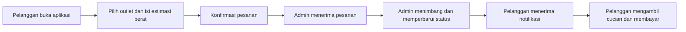

# PRD: Aplikasi Pemesanan Laundry "BersihKilat"

> Contoh terisi. Acuannya BRD v0.1. Setiap FR dan NFR harus terhubung ke BO atau BR.

| Field | Isi |
|---|---|
| Versi | 0.1 |
| Tanggal | 12 November 2026 |
| Status | Draft |
| Pemilik | [Nama Product Owner atau Business Analyst] |
| Acuan | BRD v0.1 (BO-001 sampai BO-003, BR-001 sampai BR-003) |
| Metode | Hybrid: PRD dan NFR dikunci sebelum development (Waterfall), backlog fitur dikerjakan per sprint (Agile) |

## Ringkasan

Dokumen ini menerjemahkan tujuan bisnis di BRD menjadi fitur yang bisa dibangun. Ada dua fokus utama. Pertama, pelanggan bisa memesan dan memantau cucian sendiri. Kedua, admin mencatat pesanan dengan benar tanpa harus lewat WhatsApp. Aplikasi kurir dan pembayaran online tidak masuk versi ini.

## 1. Persona Pengguna

### P-01: Ibu Rina (pelanggan rutin)
Ibu rumah tangga yang mencuci 2 sampai 3 kali seminggu dan memakai Android. Ia ingin memesan dengan cepat dan tahu kapan cucian siap. Sekarang ia harus menelepon atau chat hanya untuk menanyakan status.

### P-02: Pak Dedi (admin outlet)
Admin yang menerima pesanan di outlet, paling sibuk sore hari. Ia butuh input pesanan yang cepat, berat yang tercatat akurat, dan daftar cucian harian yang jelas. Pesanan dari chat sering terlewat karena tercampur dengan pesan lain.

### P-03: Pelanggan lansia (pengguna terbatas)
Pelanggan yang tidak nyaman dengan aplikasi dan lebih suka dibantu admin. Ia tetap perlu bisa memesan lewat admin tanpa harus memakai aplikasi. `[ASUMSI: persona ini belum divalidasi dengan data pelanggan]`

## 2. Alur Utama Pelanggan

## 3. Daftar Fitur

| ID | Nama Fitur | Penjelasan | Prioritas (MoSCoW) | Sumber |
|---|---|---|---|---|
| F-01 | Registrasi dan login pelanggan | Pelanggan membuat akun dan masuk | Must | BO-001, BO-002 |
| F-02 | Buat pesanan | Pelanggan memilih outlet, layanan, dan estimasi berat | Must | BO-001 |
| F-03 | Pelacakan status | Pelanggan melihat status cucian | Must | BO-002 |
| F-04 | Notifikasi status | Pesan otomatis saat status berubah | Must | BO-002 |
| F-05 | Pembatalan pesanan | Pelanggan membatalkan pesanan selama belum dicuci | Should | BR-002 |
| F-06 | Dashboard admin | Daftar pesanan harian dan filter status | Must | BO-001 |
| F-07 | Input berat aktual | Admin memasukkan berat hasil timbangan, harga dihitung ulang | Must | BR-001, BO-001 |
| F-08 | Riwayat pesanan | Pelanggan melihat pesanan sebelumnya | Should | BO-003 |
| F-09 | Pesan ulang | Pelanggan memesan lagi dari riwayat dengan satu ketukan | Could | BO-003 |
| F-10 | Biaya simpan | Biaya otomatis untuk cucian yang belum diambil lebih dari 7 hari | Could | BR-003 |

## 4. Kebutuhan Fungsional (Functional Requirements)

Setiap FR punya ID, kriteria uji, dan acuan ke fitur. Kriteria uji ditulis dengan angka supaya tester bisa langsung memakainya.

| ID | Kebutuhan | Acuan | Kriteria Uji |
|---|---|---|---|
| FR-001 | Pelanggan bisa mendaftar dengan nomor HP dan kata sandi | F-01 | Akun dibuat jika nomor belum terdaftar. Jika sudah, pendaftaran ditolak. |
| FR-002 | Harga pesanan dihitung dari berat (kg) dikali Rp 7.000 | F-02, F-07 | Berat 3,5 kg menghasilkan total Rp 24.500 |
| FR-003 | Sistem menolak pesanan di bawah 2 kg | F-02 | Berat 1,5 kg menampilkan pesan "minimum pesanan 2 kg" |
| FR-004 | Pembatalan hanya bisa dilakukan saat status masih "diterima" | F-05 | Pembatalan saat status "dicuci" ditolak dengan pesan yang jelas |
| FR-005 | Sistem mengirim satu notifikasi setiap status berubah | F-04 | Satu perubahan status menghasilkan tepat satu notifikasi |
| FR-006 | Admin mengubah status sesuai urutan: diterima, dicuci, disetrika, siap diambil, selesai | F-06 | Status tidak bisa dilompati |
| FR-007 | Dashboard menampilkan pesanan hari ini, dari yang paling lama | F-06 | Urutan sesuai waktu masuk |
| FR-008 | Sistem mencatat waktu setiap perubahan status | F-03, F-06 | Setiap perubahan punya timestamp (catatan waktu otomatis) |
| FR-009 | Biaya simpan Rp 2.000 per hari untuk cucian yang belum diambil lebih dari 7 hari | F-10 | Pesanan yang sudah 9 hari setelah siap kena biaya Rp 4.000 |

## 5. Kebutuhan Non-Fungsional (Non-Functional Requirements)

| ID | Kategori | Kebutuhan | Target Terukur | Acuan |
|---|---|---|---|---|
| NFR-001 | Performa | Daftar pesanan tampil cepat | Di bawah 2 detik pada 4G untuk 500 pesanan aktif | BO-001 |
| NFR-002 | Ketersediaan | Sistem bisa dipakai saat jam operasional | Uptime 99% per bulan, pukul 07.00 sampai 21.00 WIB. Itu sekitar 7 jam downtime per bulan. | BO-001 |
| NFR-003 | Keamanan | Kata sandi disimpan dalam bentuk hash | Tidak ada kata sandi dalam teks biasa | Constraint data pelanggan |
| NFR-004 | Keamanan | Dashboard hanya bisa diakses peran admin | Akses dari akun pelanggan mendapat status 403 | BR-001 |
| NFR-005 | Privasi | Data pelanggan disimpan di server dalam negeri | Sesuai konfirmasi lokasi server `[ASUMSI]` | Constraint BRD |
| NFR-006 | Kompatibilitas | Berjalan di Android 10 ke atas dan browser terbaru | Lulus uji di 3 perangkat Android dan 2 browser | Constraint BRD |
| NFR-007 | Skalabilitas | Sistem sanggup menangani pertumbuhan pesanan | Kapasitas 300 pesanan per hari selama 2 tahun `[ASUMSI]` | BO-003 |

## 6. Ketergantungan Antar Fitur

| Fitur | Bergantung pada | Alasan |
|---|---|---|
| F-02 Buat pesanan | F-01 Registrasi | Pesanan butuh akun |
| F-03 Pelacakan status | F-07 Input berat aktual | Status berubah saat admin memperbarui |
| F-04 Notifikasi | F-03 Pelacakan status | Notifikasi dipicu perubahan status |
| F-09 Pesan ulang | F-08 Riwayat | Data pesan ulang diambil dari riwayat |

## 7. Tidak Termasuk (Out of Scope)

Bagian ini mengikuti BRD, ditambah beberapa hal berikut:
- Promosi dan kupon, karena aturan bisnisnya belum ada
- Ulasan dan rating pelanggan
- Integrasi timbangan digital. Input berat tetap manual.

## 8. Keterkaitan dengan BRD

| Tujuan Bisnis | Fitur | FR dan NFR | Status |
|---|---|---|---|
| BO-001 Kurangi pesanan salah catat | F-02, F-06, F-07 | FR-002, FR-003, FR-006, NFR-001 | Tercakup |
| BO-002 Kurangi pertanyaan status | F-03, F-04 | FR-005, FR-008 | Tercakup |
| BO-003 Tambah pesanan berulang | F-08, F-09 | NFR-007 | Belum lengkap. FR untuk F-08 dan F-09 belum ada. |

BO-003 perlu tambahan FR sebelum PRD disetujui.

## 9. Pertanyaan Terbuka

1. Apakah pelanggan lansia (P-03) perlu fitur khusus, atau cukup dilayani admin?
2. Notifikasi lewat WhatsApp atau SMS? Pilihan ini memengaruhi biaya RK-003 di BRD.
3. Apakah manajemen menyetujui FR-009 (biaya simpan)?

## 10. Persetujuan

| Peran | Nama | Tanggal | Tanda Tangan |
|---|---|---|---|
| Product Owner | | | |
| Sponsor | | | |
| Tech Lead | | | |