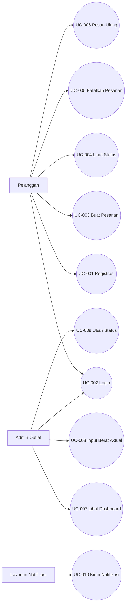
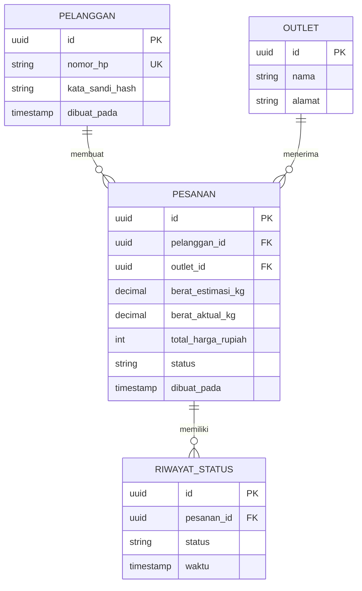
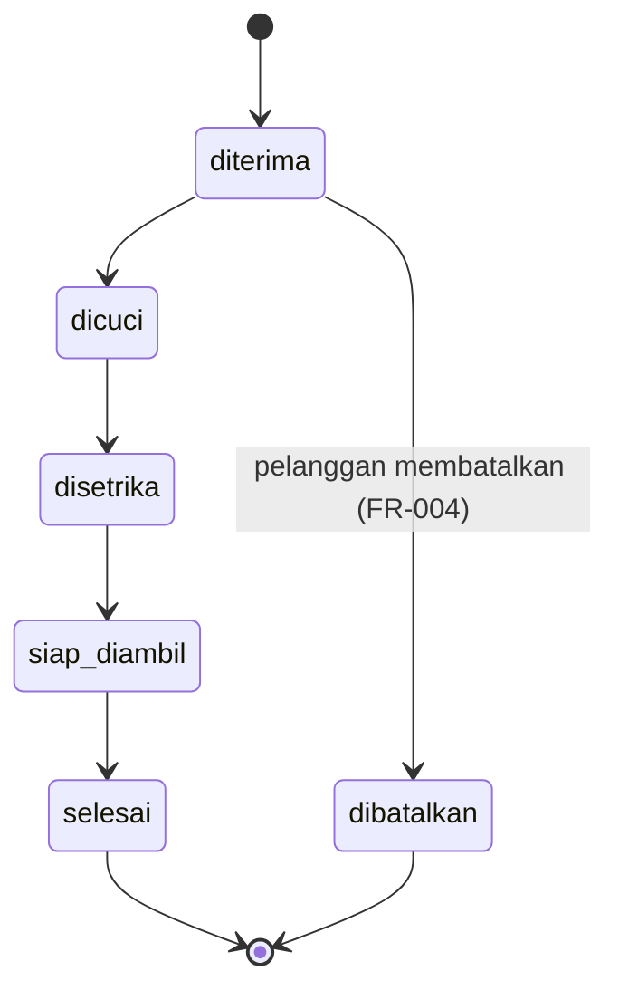

# SRS: Aplikasi Pemesanan Laundry "BersihKilat"

> Contoh terisi. Acuannya BRD v0.1 dan PRD v0.1. Setelah disetujui, perubahan wajib lewat Change Request.

| Field | Isi |
|---|---|
| Versi | 0.1 |
| Tanggal | 12 November 2026 |
| Status | Draft |
| Pemilik | [Nama System Analyst] |
| Acuan | BRD v0.1 (BO, BR), PRD v0.1 (F, FR, NFR) |
| Metode | Waterfall untuk spesifikasi, dikunci sebelum development |

## Ringkasan

Dokumen ini jadi acuan developer dan tester untuk versi pertama BersihKilat. Isinya aktor, use case, kebutuhan fungsional dan non-fungsional, serta desain data. Developer membangun fitur sesuai bagian ini, dan tester membuat test case dari kriteria uji di bagian 4 dan 5.

## 1. Pendahuluan

### 1.1 Tujuan Dokumen
Dokumen ini mengurus spesifikasi teknis. Strategi bisnis ada di BRD, dan prioritas fitur ada di PRD.

### 1.2 Ruang Lingkup Sistem
Sistem terdiri dari aplikasi pelanggan (Android dan web) dan dashboard admin (web). Kurir dan pembayaran online tidak termasuk.

### 1.3 Istilah

| Istilah | Arti |
|---|---|
| Pesanan | Satu transaksi laundry kiloan dari pelanggan |
| Status | Tahap cucian: diterima, dicuci, disetrika, siap diambil, selesai |
| Token | Kode sementara yang dibawa aplikasi untuk membuktikan pengguna sudah login. Token membuat pengguna tidak perlu login ulang di setiap halaman. |
| Hash | Hasil acak satu arah dari kata sandi. Hash tidak bisa dibalik menjadi kata sandi asli. |
| Timestamp | Catatan waktu yang dibuat otomatis oleh sistem saat sebuah kejadian terjadi |

### 1.4 Referensi

| ID | Dokumen | Versi |
|---|---|---|
| REF-01 | BRD BersihKilat | 0.1 |
| REF-02 | PRD BersihKilat | 0.1 |

## 2. Gambaran Umum

### 2.1 Posisi Sistem
Sistem ini baru dan berdiri sendiri. Sistem belum terhubung ke akuntansi.

### 2.2 Aktor

| Aktor | Jenis | Yang Bisa Dilakukan |
|---|---|---|
| Pelanggan | Eksternal | Registrasi, login, membuat pesanan, melihat status, membatalkan pesanan, melihat riwayat |
| Admin Outlet | Internal | Melihat dashboard, memasukkan berat aktual, mengubah status |
| Layanan Notifikasi | Eksternal (pihak ketiga) | Mengirim pesan status ke pelanggan |
| Penjadwal (scheduler) | Internal, otomatis | Menghitung biaya simpan setiap hari |

### 2.3 Asumsi
- Setiap outlet punya timbangan digital. `[ASUMSI: lihat AS-002 di BRD]`
- Layanan WhatsApp Business API bisa dipakai. `[ASUMSI: lihat AS-003 di BRD]`

## 3. Use Case

### 3.1 Diagram Use Case

### 3.2 UC-003: Buat Pesanan

| Field | Isi |
|---|---|
| ID | UC-003 |
| Aktor | Pelanggan |
| Acuan | F-02, FR-002, FR-003 |
| Kondisi awal | Pelanggan sudah login |
| Kondisi akhir | Pesanan tersimpan dengan status "diterima" |

**Alur utama**
1. Pelanggan membuka halaman buat pesanan.
2. Pelanggan memilih outlet.
3. Pelanggan mengisi estimasi berat dalam kilogram.
4. Sistem menghitung perkiraan harga (FR-002).
5. Pelanggan menekan "Konfirmasi".
6. Sistem menyimpan pesanan dengan status "diterima" dan mencatat timestamp (FR-008).

**Alur alternatif**
- A1 (langkah 3): Berat kurang dari 2 kg. Sistem menampilkan "minimum pesanan 2 kg" dan tidak menyimpan pesanan (FR-003).

**Alur gagal**
- E1 (langkah 6): Penyimpanan gagal karena server bermasalah. Sistem menampilkan pesan gagal. Pesanan tidak tersimpan setengah jadi.

### 3.3 UC-009: Ubah Status

| Field | Isi |
|---|---|
| ID | UC-009 |
| Aktor | Admin Outlet |
| Acuan | F-06, FR-006, FR-008, FR-005 |
| Kondisi awal | Admin sudah login dengan peran admin |
| Kondisi akhir | Status berubah, timestamp tercatat, notifikasi dikirim |

**Alur utama**
1. Admin membuka pesanan dari dashboard.
2. Admin memilih status berikutnya.
3. Sistem mengecek bahwa status baru adalah langkah selanjutnya.
4. Sistem menyimpan status dan timestamp.
5. Sistem menjalankan UC-010 untuk mengirim notifikasi.

**Alur alternatif**
- A1 (langkah 3): Status melompati tahap. Sistem menolak dan menampilkan urutan yang benar.

**Alur gagal**
- E1 (langkah 5): Notifikasi gagal terkirim. Status tetap berubah. Kegagalan dicatat supaya bisa dicoba ulang.

### 3.4 Use Case Lainnya

| ID | Nama | Acuan | Catatan |
|---|---|---|---|
| UC-001 | Registrasi | F-01, FR-001 | Nomor HP harus unik |
| UC-002 | Login | F-01, NFR-003, NFR-004 | Kata sandi dicek lewat hash |
| UC-004 | Lihat Status | F-03, FR-008 | Data diambil ulang setiap halaman dibuka |
| UC-005 | Batalkan Pesanan | F-05, FR-004 | Hanya saat status "diterima" |
| UC-006 | Pesan Ulang | F-09 | Menyalin pesanan dari riwayat. Prioritas Could. |
| UC-007 | Lihat Dashboard | F-06, FR-007 | Urut dari yang paling lama |
| UC-008 | Input Berat Aktual | F-07, FR-002 | Harga dihitung ulang otomatis |
| UC-010 | Kirim Notifikasi | F-04, FR-005 | Satu pesan per perubahan status |

## 4. Kebutuhan Fungsional

Setiap kebutuhan sudah dicakup use case di bagian 3. Kolom kriteria uji bisa langsung dipakai untuk test case.

| ID | Kebutuhan | Use Case | Kriteria Uji |
|---|---|---|---|
| FR-001 | Akun dibuat dengan nomor HP dan kata sandi | UC-001 | Nomor baru berhasil. Nomor terdaftar ditolak. |
| FR-002 | Harga = berat (kg) x Rp 7.000 | UC-003, UC-008 | 3,5 kg menghasilkan Rp 24.500 |
| FR-003 | Berat di bawah 2 kg ditolak | UC-003 | 1,5 kg menampilkan "minimum pesanan 2 kg" |
| FR-004 | Pembatalan hanya saat status "diterima" | UC-005 | Pembatalan saat "dicuci" ditolak |
| FR-005 | Satu notifikasi per perubahan status | UC-009, UC-010 | Satu perubahan menghasilkan tepat satu notifikasi |
| FR-006 | Status hanya berubah sesuai urutan | UC-009 | Lompat dari "diterima" ke "siap diambil" ditolak |
| FR-007 | Dashboard diurutkan dari waktu masuk terlama | UC-007 | Urutan sesuai timestamp masuk |
| FR-008 | Setiap perubahan status punya timestamp | UC-003, UC-009 | Tidak ada perubahan status tanpa timestamp |
| FR-009 | Biaya simpan Rp 2.000 per hari setelah 7 hari | Penjadwal | Pesanan yang 9 hari setelah "siap diambil" kena Rp 4.000 |

## 5. Kebutuhan Non-Fungsional

| ID | Kategori | Kebutuhan | Target Terukur | Cara Verifikasi |
|---|---|---|---|---|
| NFR-001 | Performa | Daftar pesanan tampil cepat | Di bawah 2 detik pada 4G, 500 pesanan aktif | Load test |
| NFR-002 | Ketersediaan | Sistem bisa dipakai saat jam operasional | Uptime 99% per bulan, 07.00 sampai 21.00 WIB | Monitoring |
| NFR-003 | Keamanan | Kata sandi disimpan sebagai hash | 0 kata sandi dalam teks biasa | Code review dan cek database |
| NFR-004 | Keamanan | Dashboard hanya untuk peran admin | Akses dari akun pelanggan mendapat 403 | Uji otorisasi |
| NFR-005 | Privasi | Data pelanggan di server dalam negeri | Sesuai konfirmasi lokasi server | Dokumen infrastruktur |
| NFR-006 | Kompatibilitas | Android 10 ke atas dan browser terbaru | Lulus di 3 perangkat Android dan 2 browser | Uji perangkat |
| NFR-007 | Skalabilitas | Kapasitas 300 pesanan per hari | Lulus load test selama 2 tahun `[ASUMSI]` | Load test |

## 6. Antarmuka Eksternal

### 6.1 Antarmuka Pengguna
Pelanggan memakai aplikasi Android dan web. Admin memakai dashboard web di browser perangkat outlet.

### 6.2 Layanan Pihak Ketiga

| ID | Layanan | Arah | Protokol | Penanganan Gagal |
|---|---|---|---|---|
| IF-01 | WhatsApp Business API (notifikasi) | Keluar dari sistem | HTTPS dengan format JSON | Coba ulang maksimal 3 kali, lalu catat di log |

### 6.3 Format Data
Semua respons API memakai JSON. Waktu memakai format ISO 8601 dan zona waktu WIB (UTC+7).

## 7. Desain Data

### 7.1 Model Data

### 7.2 Kamus Data (ringkas)

| Tabel | Kolom | Tipe | Aturan |
|---|---|---|---|
| PELANGGAN | nomor_hp | string | Unik, format 08xxxxxxxxxx |
| PELANGGAN | kata_sandi_hash | string | Wajib hash (NFR-003) |
| PESANAN | berat_estimasi_kg | decimal(5,2) | Minimal 2,00 (FR-003) |
| PESANAN | berat_aktual_kg | decimal(5,2) | Diisi admin saat menimbang. Boleh kosong sebelum itu. |
| PESANAN | total_harga_rupiah | integer | Dihitung dari berat (FR-002) |
| PESANAN | status | enum | diterima, dicuci, disetrika, siap_diambil, selesai |
| RIWAYAT_STATUS | waktu | timestamp | Wajib, dicatat sistem (FR-008) |

ERD dan kamus data harus diperbarui bersama setiap perubahan schema.

### 7.3 Siklus Status Pesanan

## 8. Keterlacakan (Traceability)

| FR | Use Case | Test Case (rencana) |
|---|---|---|
| FR-001 | UC-001 | TC-001, TC-002 |
| FR-002 | UC-003, UC-008 | TC-010, TC-011 |
| FR-003 | UC-003 | TC-012 |
| FR-004 | UC-005 | TC-020, TC-021 |
| FR-005 | UC-009, UC-010 | TC-030 |
| FR-006 | UC-009 | TC-031 |
| FR-007 | UC-007 | TC-040 |
| FR-008 | UC-003, UC-009 | TC-032 |
| FR-009 | Penjadwal | TC-050 |
| NFR-001 sampai NFR-007 | Lintas use case | TC-900 sampai TC-906 |

FR-009 belum punya use case sendiri. Buat UC-011 sebelum SRS disetujui.

## 9. Pertanyaan Terbuka

1. Notifikasi lewat WhatsApp atau SMS? Pilihan ini memengaruhi IF-01 dan RK-003.
2. Apakah nomor HP boleh diubah setelah registrasi?
3. Apakah admin juga boleh membatalkan pesanan, atau hanya pelanggan?

## 10. Persetujuan

| Peran | Nama | Tanggal | Tanda Tangan |
|---|---|---|---|
| System Analyst | | | |
| Tech Lead | | | |
| Product Owner | | | |
| Sponsor | | | |