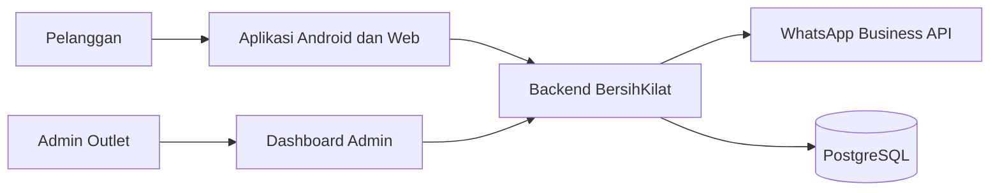
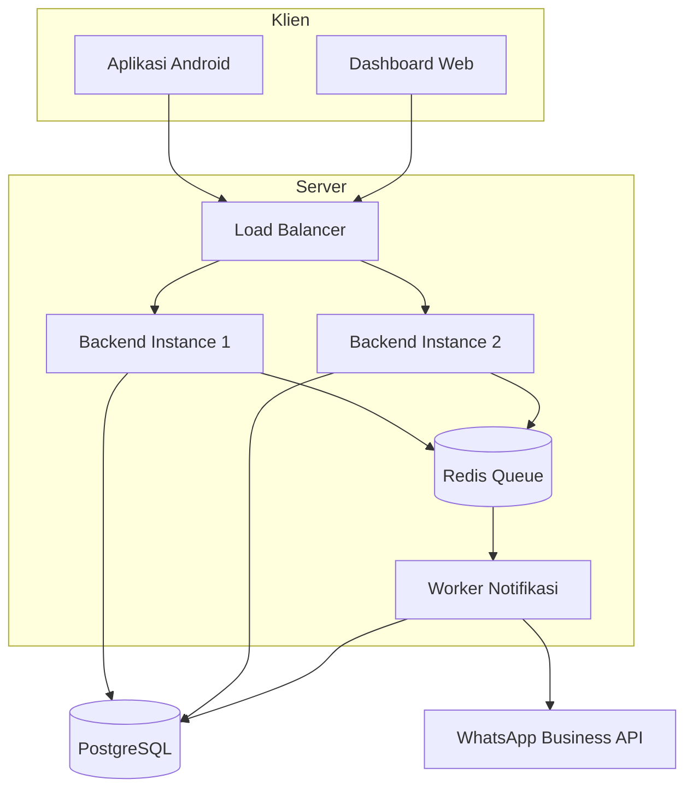

# Tech Spec: Aplikasi Pemesanan Laundry "BersihKilat"

> Contoh terisi. Acuannya BRD v0.1, PRD v0.1, SRS v0.1, dan ERD di SRS bagian 7. Versi yang bertanda `[VERIFIKASI]` harus dicek ulang dari dokumentasi resmi sebelum dokumen disetujui.

| Field | Isi |
|---|---|
| Versi | 0.1 |
| Tanggal | 12 November 2026 |
| Status | Draft |
| Pemilik | [Nama Solution Architect] |
| Acuan | BRD v0.1, PRD v0.1, SRS v0.1 |
| ADR terkait | ADR-001 sampai ADR-005 |

## Ringkasan

Tech spec ini menentukan stack, pola arsitektur, dan aturan kode untuk versi pertama BersihKilat. Pola yang dipakai adalah modular monolith, yaitu satu aplikasi backend yang dibagi menjadi modul-modul terpisah. Volume pesanan saat ini sekitar 120 per hari, dan NFR-007 menargetkan 300 per hari. Di angka ini, satu codebase lebih cepat dikerjakan tim kecil dibanding beberapa layanan yang harus dirawat sekaligus. Setiap modul tetap bisa dipisah menjadi layanan sendiri nanti, kalau ada alasan yang kuat.

## 1. Konteks dari Dokumen Analis

| Sumber | Yang Memengaruhi Arsitektur |
|---|---|
| NFR-001 | Daftar pesanan harus tampil dalam 2 detik pada 4G untuk 500 pesanan aktif. Perlu pagination dan indeks database. |
| NFR-002 | Uptime 99% per bulan pada jam 07.00 sampai 21.00 WIB. Perlu minimal dua instance backend. |
| NFR-003 | Kata sandi disimpan dalam bentuk hash. Hash dibuat di backend. |
| NFR-004 | Akses admin dicek di server, bukan hanya disembunyikan di tampilan. |
| NFR-005 | Data pelanggan disimpan di server dalam negeri `[ASUMSI]`. Pilihan hosting menunggu konfirmasi ini. |
| NFR-006 | Android 10 ke atas dan browser terbaru. Framework mobile yang dipilih harus mendukung Android 10. |
| NFR-007 | Kapasitas 300 pesanan per hari selama 2 tahun `[ASUMSI]`. |
| IF-01 | WhatsApp Business API untuk notifikasi. Perlu antrean (queue) dan mekanisme coba ulang. |
| Constraint BRD | Anggaran pengembangan maksimal Rp 180 juta. Biaya operasional sekitar Rp 3 juta per bulan. |

## 2. Stack Teknologi

| Lapisan | Teknologi | Versi | Status | ADR |
|---|---|---|---|---|
| Backend | Node.js dengan TypeScript | LTS terbaru `[VERIFIKASI]` | Accepted | ADR-001 |
| Framework backend | Fastify | `[VERIFIKASI]` | Accepted | ADR-001 |
| Database | PostgreSQL | 16 `[VERIFIKASI]` | Accepted | ADR-002 |
| ORM (alat pemetaan tabel ke kode) | Prisma | `[VERIFIKASI]` | Accepted | ADR-002 |
| Antrean | Redis dengan BullMQ | `[VERIFIKASI]` | Proposed | ADR-004 |
| Aplikasi Android dan web | React Native untuk Android, React untuk web | `[VERIFIKASI]` | Proposed | ADR-003 |
| Hosting | Penyedia cloud dengan region Indonesia | `[ASUMSI]` | Proposed | ADR-005 |
| Notifikasi | WhatsApp Business API | Mengikuti dokumentasi penyedia | Accepted | SRS IF-01 |

Versi library belum diverifikasi, jadi kolom versi masih berisi `[VERIFIKASI]`. Angka ini belum final.

## 3. Pola Arsitektur

### 3.1 Context (C4 level 1)



### 3.2 Container (C4 level 2)



### 3.3 Modul Backend (C4 level 3, modul utama)

| Modul | Tanggung Jawab | Acuan |
|---|---|---|
| `auth` | Registrasi, login, token, dan pengecekan peran | FR-001, UC-001, UC-002, NFR-003, NFR-004 |
| `pesanan` | Membuat pesanan, menghitung harga, membatalkan pesanan | FR-002, FR-003, FR-004, FR-008 |
| `status` | Mengubah status sesuai urutan dan mencatat riwayat | FR-005, FR-006, FR-008 |
| `dashboard` | Daftar pesanan harian untuk admin | FR-007, NFR-001 |
| `notifikasi` | Mengirim pesan status lewat antrean | FR-005, IF-01 |
| `biaya` | Menghitung biaya simpan harian lewat penjadwal (scheduler) | FR-009 |
| `outlet` | Data outlet dan daftar harga | BR-001 |

Aturan antarmodul: modul lain hanya boleh memanggil fungsi publik yang diekspor dari `index.ts` milik modul tersebut. Modul tidak boleh membaca tabel milik modul lain secara langsung. Aturan ini membuat perubahan di satu modul tidak merusak modul lain.

## 4. Struktur Folder

```
bersihkilat-backend/
├── src/
│   ├── modules/
│   │   ├── auth/
│   │   │   ├── auth.routes.ts
│   │   │   ├── auth.service.ts
│   │   │   ├── auth.schema.ts
│   │   │   └── index.ts
│   │   ├── pesanan/
│   │   ├── status/
│   │   ├── dashboard/
│   │   ├── notifikasi/
│   │   ├── biaya/
│   │   └── outlet/
│   ├── shared/
│   │   ├── db/           (koneksi dan client Prisma)
│   │   ├── errors/       (kelas error standar)
│   │   ├── logger/
│   │   └── middleware/
│   └── main.ts
├── prisma/
│   ├── schema.prisma
│   └── migrations/
├── tests/
│   ├── unit/
│   ├── integration/
│   └── e2e/
└── openapi/
    └── api.yaml
```

Folder memakai `kebab-case`. File memakai pola `nama.jenis.ts`, misalnya `auth.service.ts`.

## 5. Konvensi Kode

- Bahasa: TypeScript dengan mode `strict` aktif. Mode ini membuat kesalahan tipe data tertangkap saat kode ditulis, bukan saat aplikasi berjalan.
- Format dan lint memakai Prettier dan ESLint. Konfigurasinya disimpan di repo, supaya semua developer memakai aturan yang sama.
- Nama variabel dan fungsi memakai bahasa Inggris. Istilah bisnis boleh memakai bahasa Indonesia kalau ada di glosarium, misalnya `pesanan`, `status`, dan `outlet`.
- Validasi input memakai Zod (pustaka validasi data) atau yang sejenis, di setiap titik masuk data: endpoint dan pesan antrean.
- Error memakai kelas dari `shared/errors`. Semua endpoint mengembalikan format error yang sama, sehingga aplikasi klien bisa menanganinya dengan satu cara.
- Dilarang memakai `console.log` di kode produksi. Gunakan logger.
- Nomor HP, kata sandi, dan alamat tidak boleh masuk ke log.
- Waktu disimpan dalam UTC dan ditampilkan dalam WIB (SRS bagian 6.3).

## 6. Autentikasi dan Otorisasi

- Autentikasi (auth) adalah proses memastikan pengguna benar-benar pemilik akun. Login menghasilkan dua token: token akses yang berumur 15 menit, dan refresh token (token untuk memperbarui token akses) yang berumur 30 hari `[ASUMSI]`.
- Token dikirim lewat header `Authorization`, bukan lewat URL. Token di URL bisa tercatat di riwayat browser dan log server.
- Peran pengguna disimpan di tabel pengguna. Otorisasi (pengecekan hak akses) dilakukan di middleware, yaitu lapisan di server yang memeriksa setiap permintaan sebelum sampai ke fungsi utama. Semua endpoint admin menerapkan pengecekan ini (NFR-004).
- Kata sandi di-hash dengan bcrypt. Biaya hash dipilih supaya satu verifikasi memakan sekitar 250 milidetik di server `[VERIFIKASI]`.
- Batas percobaan login: 5 kali per 15 menit untuk setiap nomor HP `[ASUMSI]`.

## 7. Data dan Migrasi

- Setiap perubahan schema dilakukan lewat migration Prisma. Tidak ada perubahan tabel manual di produksi.
- Setiap migration ditinjau sebelum digabung ke cabang utama.
- Backup database dilakukan setiap hari dengan retensi 14 hari `[ASUMSI]`. RPO dan RTO belum disepakati, lihat pertanyaan terbuka.
- Indeks dibuat sesuai ERD di SRS bagian 7. Alasan setiap indeks dicatat di kamus data.

## 8. Antrean dan Notifikasi

- Perubahan status menghasilkan satu pesan di antrean `kirim_notifikasi`. Sistem tidak memanggil WhatsApp secara langsung dari proses ubah status. Pemisahan ini membuat admin tidak perlu menunggu pengiriman pesan selesai (FR-005).
- Worker mencoba ulang pengiriman sampai 3 kali dengan jeda yang makin panjang (exponential backoff), sesuai IF-01.
- Pesan yang gagal setelah 3 kali dipindahkan ke dead letter queue (antrean khusus pesan gagal) supaya admin bisa memeriksanya.
- Status setiap pesan dicatat di tabel `notifikasi_log`.

## 9. Deployment dan Observabilitas

- Deploy memakai rolling update: instance diperbarui satu per satu. Dengan cara ini layanan tetap berjalan selama proses deploy, dan ini menjaga uptime (NFR-002).
- Setiap instance punya endpoint health check di `/health` yang dipantau load balancer.
- Log ditulis dalam format JSON. Setiap permintaan punya request ID, sehingga satu permintaan bisa dilacak dari awal sampai akhir.
- Metrik minimal: jumlah permintaan per menit, waktu respons persentil ke-95, jumlah error, panjang antrean, dan jumlah notifikasi gagal.
- Alert dikirim ke tim IT kalau tingkat error di atas 1% dalam 5 menit, atau antrean lebih dari 100 pesan `[ASUMSI]`.

## 10. Strategi Testing

| Jenis | Cakupan | Alat | Target |
|---|---|---|---|
| Unit | Logika harga, validasi status, perhitungan biaya simpan | Vitest `[VERIFIKASI]` | Aturan BR-001 sampai BR-003 teruji penuh |
| Integrasi | Endpoint dan database | Vitest dengan database uji | Setiap FR punya minimal satu test |
| End-to-end | Alur dari pesanan sampai notifikasi | Playwright `[VERIFIKASI]` | Alur utama UC-003 dan UC-009 |
| Beban (load) | NFR-001 dan NFR-007 | k6 `[VERIFIKASI]` | 500 pesanan aktif dan 300 pesanan per hari |

Test case di SRS bagian 8 dipetakan ke test otomatis. Setiap test menyebut ID TC di nama atau komentarnya, supaya laporan test bisa ditelusuri balik ke SRS.

## 11. Daftar Library

| Status | Library | Alasan |
|---|---|---|
| Boleh | Fastify, Prisma, Zod, bcrypt, BullMQ, Pino (logger) | Sudah dipilih di ADR |
| Boleh dengan persetujuan | Library UI untuk dashboard | Perlu ADR kalau ukurannya besar |
| Dilarang | MD5 atau SHA-1 untuk kata sandi | Tidak aman untuk kata sandi (NFR-003) |
| Dilarang | ORM kedua selain Prisma | Dua ORM membuat pemetaan data membingungkan |
| Dilarang | Library yang tidak dirawat lebih dari 2 tahun | Berisiko untuk keamanan dan kompatibilitas |

## 12. Risiko Teknis

| ID | Risiko | Dampak | Mitigasi |
|---|---|---|---|
| RT-001 | Hosting berada di luar negeri kalau NFR-005 belum dikonfirmasi | Tinggi | Pemilihan hosting ditunda sampai ada konfirmasi |
| RT-002 | WhatsApp Business API membatasi jumlah pesan | Sedang | Antrean dan batas kirim per menit |
| RT-003 | Redis menjadi titik gagal tunggal | Sedang | Redis dengan replika, atau layanan Redis terkelola |

## 13. Pertanyaan Terbuka

1. Apakah NFR-005 (lokasi server di dalam negeri) sudah dikonfirmasi? Jawabannya menentukan ADR-005.
2. Apakah tim developer sudah menguasai TypeScript, atau perlu pelatihan?
3. Berapa biaya hosting per bulan yang disetujui?

## 14. Persetujuan

| Peran | Nama | Tanggal | Tanda Tangan |
|---|---|---|---|
| Solution Architect | | | |
| Tech Lead | | | |
| System Analyst | | | |
